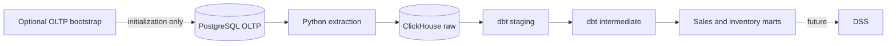

# Inventory DW & DSS

A pharmaceutical sales and inventory warehouse for analysis and future decision support. PostgreSQL is the operational source of record.

## Architecture



Extraction reads OLTP; CSV files are used only by the optional OLTP bootstrap and source lineage validation. Python and dbt run locally through `uv`. Docker Compose runs PostgreSQL and ClickHouse.

## Repository

| Path | Responsibility |
|---|---|
| `src/inventory_dw_dss/` | CLI, extraction, optional OLTP bootstrap, read-only validators |
| `transform/dbt/` | Staging, sales/inventory intermediate models, conformed dimensions, facts, seeds, tests |
| `sql/oltp/` | Transactional schema and bootstrap loading SQL |
| `infra/` | PostgreSQL and ClickHouse services |
| `data/` | Source files, bootstrap outputs, governed references |
| `tests/` | Unit and disposable-database regression tests |
| `docs/` | Architecture, operations, model rules and source references |

## Prerequisites and quick start

Requires Python 3.12+, `uv` and Docker Compose. Run commands from the repository root:

```bash
uv sync --locked
docker compose -p inventory-dw-dss -f infra/docker-compose.yml up -d --wait
uv run --locked inventory-dw-dss extract --batch-size 20000
uv run --locked dbt build --project-dir transform/dbt --profiles-dir transform/dbt \
  --vars '{"uom_mapping_version":"uom_mapping_v2_2026-11-08"}'
```

Run extraction before dbt, sequentially. Extraction uses inclusive per-table event-time watermarks for sales lines and inventory movements, and fully refreshes ten reference/header tables. It cannot automatically synchronize historical edits, late arrivals older than the watermark, or deletions. Details and recovery steps are in [extraction operations](docs/extraction.md).

CSV bootstrap is a separate, optional one-time workflow for reconstructing OLTP. See [bootstrap instructions](docs/oltp/ingestion.md); it uses the optional `bootstrap` dependency group. The operational extraction command does not read CSV files.

## Current capabilities

- PostgreSQL-to-ClickHouse raw extraction with reconciliation and per-table publication.
- Twelve typed and normalized staging views.
- Recorded sales enrichment, observed daily sales by original unit, and a sales-line fact preserving governed UOM conversion.
- Shared product, unit and date dimensions; warehouse dimension for inventory facts.
- Source-ordered inventory ledgers, continuity segments, gap diagnostics, movement facts and daily observed inventory facts.
- Source, grain, balance, lineage and UOM quality checks.

## Validation

```bash
uv run --locked dbt debug --project-dir transform/dbt --profiles-dir transform/dbt
uv run --locked dbt parse --project-dir transform/dbt --profiles-dir transform/dbt
uv run --locked dbt compile --project-dir transform/dbt --profiles-dir transform/dbt
uv run --locked dbt build --project-dir transform/dbt --profiles-dir transform/dbt \
  --vars '{"uom_mapping_version":"uom_mapping_v2_2026-11-08"}'
uv run --locked python -m unittest discover -s tests/extraction -v
uv run --locked python -m unittest discover -s tests/validation -v
uv run --locked python -m unittest discover -s tests/uom -v
uv run --locked --group bootstrap python -m unittest discover -s tests/oltp_ingestion -v
```

Disposable database integration checks and read-only data validators are described in [tests](tests/README.md). Generated reports and dbt artifacts are local outputs.

## Important interpretation limits

Inventory models preserve recorded observations; they do not certify physical or available stock. Source order uses the verified export's `dataset_row_number` within dataset, product and warehouse. Gaps remain visible; each starts a separately anchored segment. Missing dates are not filled or carried forward, and conflicting latest-time observations are flagged. Sales quantities stay in their original units unless an explicitly approved, version-pinned UOM factor applies. Sales are not classified as net of returns. The data does not establish historical transaction arrival/correction times, warehouse assignment for sales, or point-in-time availability.

See [star schema](docs/design/star-schema.md), [architecture](docs/architecture.md), [intermediate rules](docs/intermediate.md), [historical inventory](docs/historical-inventory.md), [UOM governance](docs/uom.md), [source-sequence evidence](docs/source-sequence-integrity.md), and [OLTP schema](docs/oltp/schema.md).
