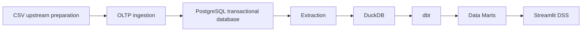

# System architecture

Only upstream preparation and OLTP ingestion are implemented. The remaining components describe the intended architecture, not executable workflows.

Reusable ingestion code lives under `src/inventory_dw_dss/oltp_ingestion`. The project CLI lazily loads this package for the explicit `bootstrap` command. Pandas belongs to the optional `bootstrap` dependency group; the default package does not import it. SQL, tests, infrastructure and documentation are separate from application code.

Operational DW extraction must read `oltp.*` through a database connection and a consistent read-only snapshot. It must not import ingestion modules, initialize/migrate OLTP, start the upstream container, read original/prepared CSVs, or fall back to CSV on database errors. Historical `staging.*_raw` tables are not DW sources.

The local Docker project name remains `inventory-dw-dss`; the named volume remains `inventory-dw-dss_pgdata`. Moving the Compose file does not create a new source database when the documented project name is used. Do not remove the volume to update code or schema.

See [schema and business rules](oltp/schema.md) and [ingestion execution](oltp/ingestion.md).
