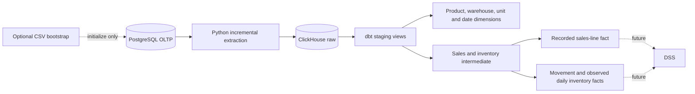

# Architecture

PostgreSQL is the operational source of record. Extraction and dbt run locally through `uv`; Docker Compose provides PostgreSQL and ClickHouse. Local endpoints are PostgreSQL port 5433 and ClickHouse HTTP port 8123.

## Extraction

The extractor reads twelve OLTP tables in one repeatable-read, read-only transaction. Sales lines and inventory movements use separate inclusive event-time watermarks. Ten reference and header tables refresh fully. Each table is validated in a temporary ClickHouse database and published individually. Run extraction before dbt, sequentially. Historical corrections, late arrivals before a watermark and source deletions are not synchronized automatically. See [extraction operations](extraction.md).

Raw stores PostgreSQL values as text and preserves source NULLs. Twelve staging views validate types and normalize fields while preserving each source record. Source files are not runtime extraction dependencies.

## Dimensions and facts

Four full-refresh dimensions share existing OLTP numeric identities for product, warehouse and unit; the calendar uses `Date32` dates. Product attributes use Type 1 current catalog values, with optional manufacturer/class/category labels preserved as NULL. All three facts share product, unit and date roles. Warehouse relates to inventory facts only.

`fct_sales_line` preserves all 57 columns of the governed conversion view, including original quantities, financial fields, line attributes, conversion status and version/evidence. Identity and approved conversions provide stock-unit quantities; unsupported results remain NULL. Invoice, cashier and optional batch identities remain line descriptors.

Inventory models retain every source movement, order each dataset/product/warehouse ledger by verified export sequence, and anchor continuity segments at recorded openings. Inventory marts expose movement-level quantities and the coherent last source observation on each observed day. Diagnostics preserve gaps, negatives and latest-time conflicts. Calendar rows do not generate inventory observations or sales activity.

Dimensions, ledger, segments and the three facts use fully rebuilt MergeTree tables. Supporting enrichment, governed conversion and diagnostic models remain views. Publication is per relation; downstream readers should use results after a successful complete build. See the [star schema](design/star-schema.md) for grains, keys, measure aggregation and tests.

## Interpretation and validation

Recorded sales do not establish net demand or sales warehouse. Observed balances do not certify physical or available stock. Missing dates remain absent; quantities in different product/unit scopes are not pooled. Type 1 catalogs and event timestamps do not establish historical arrival/correction knowledge. Carry-forward, SCD2, availability/PIT feature marts and the DSS application are outside the implemented scope.

CSV preparation and OLTP initialization are optional bootstrap tasks. Read-only validators reconcile source sequence and inventory history; dbt tests additionally check dimensional schema, FK coverage, join cardinality and complete sales/source preservation. Test mutation scenarios use disposable databases. References and immutable UOM snapshots remain under `data/reference/`.

[OLTP schema](oltp/schema.md) · [Bootstrap](oltp/ingestion.md) · [Intermediate rules](intermediate.md) · [Tests](../tests/README.md)
