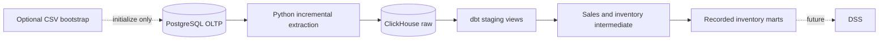

# Architecture

PostgreSQL is the operational source of record. Extraction and dbt run locally through `uv`; Docker Compose provides PostgreSQL and ClickHouse. The Compose project uses PostgreSQL port 5433 and ClickHouse HTTP port 8123.

## Extraction

The extractor reads all twelve OLTP tables in one repeatable-read, read-only transaction. Sales lines and inventory movements use separate inclusive event-time watermarks. Ten reference and header tables refresh fully. Each table is validated in a temporary ClickHouse database and published individually. Extraction and dbt must run sequentially. Historical corrections, late arrivals before a watermark and source deletions are not synchronized automatically. See [extraction operations](extraction.md).

Raw stores PostgreSQL values as text, preserving source NULLs. Staging casts, names and normalizes source fields while preserving each source row's grain. Staging models are grouped by sales, inventory and reference domains.

## Transformation

Sales intermediate models preserve recorded invoice lines, enrich them with available identifiers and aggregate only observed product/date/unit combinations. A separate view applies the selected governed UOM version.

Inventory movements are ordered by the verified export sequence within dataset/product/warehouse. The models preserve classifications and signed observations, identify discontinuities and start a new segment at each gap. Inventory marts expose recorded movements and observed daily balances/flows. Ledger, segment and mart tables rebuild on dbt runs; supporting enrichment and diagnostics remain views.

The observed inventory outputs do not certify physical stock or historical availability. Missing dates are not filled. Carry-forward, point-in-time availability features, conformed dimensions and the DSS application are not implemented.

## Bootstrap and validation

CSV preprocessing and OLTP initialization are optional bootstrap tasks, separate from the operational extraction pipeline. Validation modules issue read-only queries; scripts provide thin entry points. Source sequence evidence and immutable UOM references are maintained under `data/reference/` and documented in [source-sequence integrity](source-sequence-integrity.md) and [UOM governance](uom.md).

[OLTP schema](oltp/schema.md) · [Bootstrap](oltp/ingestion.md) · [Intermediate rules](intermediate.md)
