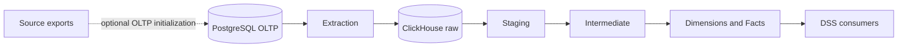

# System architecture

The warehouse turns recorded pharmacy transactions into analytical tables for the DSS team. PostgreSQL is the transactional system of record; ClickHouse stores the extracted raw copy and analytical relations.

The operational path is **PostgreSQL → extraction → ClickHouse raw → dbt Staging → Intermediate → Marts → DSS**. Original CSV exports are used only for optional OLTP reconstruction and reviewed source evidence; the DW extraction path reads PostgreSQL.

Staging expresses source records with analytical names and types. Intermediate models add reusable business calculations while retaining source grain where required. Marts provide four shared dimensions, three source-preserving facts and two replenishment facts. The [MMS package](../src/inventory_dw_dss/mms/README.md) reads the replenishment facts to score stockout risk, propose orders and record manager decisions.

Extraction and dbt transformations are separate stages. Raw publication is per source table; dbt rebuilds persistent analytical tables per relation. Consumers should use a release only after extraction and the complete dbt build have both succeeded.

System boundaries and interpretation limits are described in [data semantics](data-semantics.md), [source system](source-system.md), and [data model](data-model.md). Code-level operation and maintenance instructions live beside their implementation: [Python pipeline](../src/inventory_dw_dss/README.md), [dbt project](../transform/dbt/README.md), and [services](../infra/README.md).
