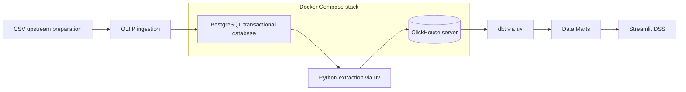

# System architecture

The unified Compose file starts PostgreSQL and ClickHouse with persistent named volumes. Python extraction and dbt run locally through `uv`, using PostgreSQL port 5433 and ClickHouse HTTP port 8123 by default. Extraction reads each transaction table from its inclusive raw event-time watermark and refreshes 10 reference/header tables in one read-only repeatable-read snapshot. It merges transactions by PK in temporary MergeTree tables, reconciles counts/keys, and publishes replacements. Older late arrivals, historical changes and transaction deletions are outside this event-time loading contract. Raw stores canonical text and NULLs; twelve dbt staging views apply analytical types without changing grain. Dimensional models, marts and Streamlit DSS are not implemented yet. See [extraction](extraction.md) for the publication boundary and recovery procedure.

The remaining boxes describe the intended pipeline.

Reusable ingestion code lives under `src/inventory_dw_dss/oltp_ingestion`. The project CLI lazily loads this package for the explicit `bootstrap` command. Pandas belongs to the optional `bootstrap` dependency group; the default package does not import it. SQL, tests, infrastructure and documentation are separate from application code.

Operational DW extraction must read `oltp.*` through a database connection and a consistent read-only snapshot. It must not import ingestion modules, initialize/migrate OLTP, start the upstream container, read original/prepared CSVs, or fall back to CSV on database errors. Historical `staging.*_raw` tables are not DW sources.

The local Docker project name remains `inventory-dw-dss`; the named PostgreSQL volume remains `inventory-dw-dss_pgdata`. ClickHouse data lives in the separate `inventory-dw-dss_clickhouse_data` volume. Use the documented Compose project name to reuse existing OLTP data. Do not remove volumes to update code or schema.

See [schema and business rules](oltp/schema.md) and [ingestion execution](oltp/ingestion.md).
