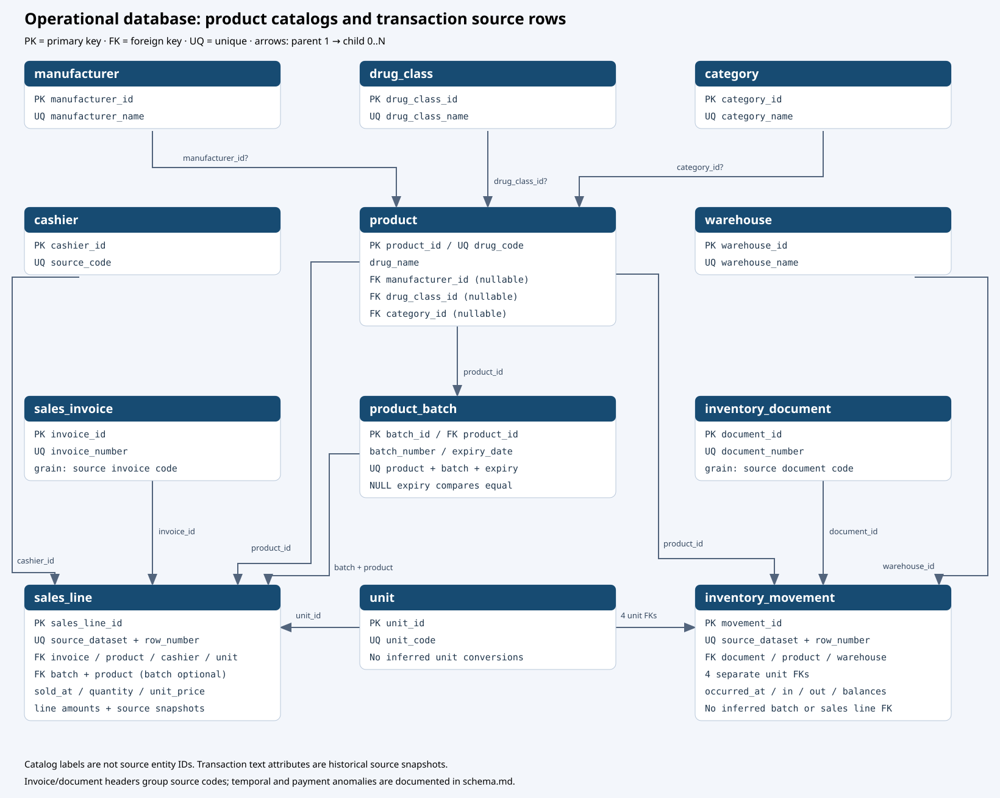
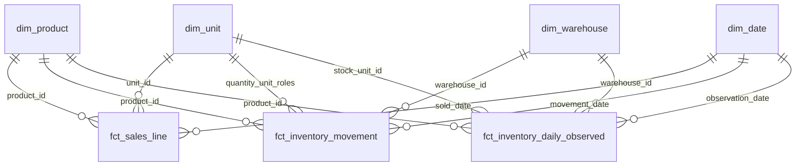

# Data model

The system contains a transactional PostgreSQL model and a ClickHouse dimensional model. This page documents their system-level grains and relationships. Exact SQL types, column contracts, transformations and tests are maintained with the code in the [OLTP schema guide](../sql/oltp/README.md) and [dbt model guides](../transform/dbt/models/README.md).

## Transactional source model

The operational model has 12 `oltp` tables. Reference entities are `product`, `manufacturer`, `drug_class`, `category`, `unit`, `cashier` and `warehouse`. `sales_invoice`, `inventory_document` and `product_batch` provide source/header groupings. The two transaction tables are:

| Table | Grain | Source identity |
|---|---|---|
| `sales_line` | One source sales item row | `(source_dataset, source_row_number)` |
| `inventory_movement` | One source stock movement row | `(source_dataset, source_row_number)` |

Each sales line references one product, invoice, cashier and original unit; its optional batch must belong to that same product. A product batch is identified by product, batch number and expiry date. Missing batches remain missing. Each inventory movement references one product, warehouse, document and the four units recorded for opening, inbound, outbound and closing quantities.

A source invoice number can group sales lines, but source observations show differences in time, shift/cashier and payment fields within some invoice codes. Those fields remain on the sales line. Inventory document codes also span differing times and warehouses; movement-specific attributes remain on movement rows. These identifiers are source groupings, not proof that every associated field has one invoice/document-wide value.

The OLTP catalog has nullable manufacturer, drug-class and category references. Transaction-recorded product labels are retained separately from the current product catalog. There is no sales-line-to-inventory-movement relationship, no inventory batch assignment and no sales warehouse relationship.

## Analytical star schema

The Marts layer exposes four dimensions and three facts. Product, warehouse and unit dimensions reuse numeric OLTP IDs; `dim_date` uses calendar dates.

| Model | Grain / identifying key | Relationship scope |
|---|---|---|
| `dim_product` | One current catalog product / `product_id` | All three facts |
| `dim_warehouse` | One warehouse / `warehouse_id` | Inventory facts only |
| `dim_unit` | One source unit label / `unit_id` | Sales original/verified unit and inventory quantity roles |
| `dim_date` | One calendar day / `calendar_date` | Sales date and inventory event/observation dates |
| `fct_sales_line` | One source sales line / `sales_invoice_line_id`; lineage key `(dataset_name, dataset_row_number)` | Product × original unit × sold date; no warehouse FK |
| `fct_inventory_movement` | One source movement / `inventory_movement_id` | Product × warehouse × movement date and recorded quantity units |
| `fct_inventory_daily_observed` | Dataset × product × warehouse × observed date | One selected recorded closing observation per observed day |

`dim_product` uses current Type 1 catalog attributes; it does not recreate past catalog states. `fct_sales_line` preserves all 57 columns from the governed sales conversion model, including original values and mapping provenance. Candidate, quarantined and unmapped converted quantities remain NULL. Inventory facts preserve the source rows, their recorded order, segment anchors and observation quality flags. Missing observation dates are not generated.

Facts do not relate sales to inventory by individual movement. Compare separately aggregated product/date/unit scopes only when units are compatible; warehouse-level demand cannot be attributed from this source. The [business semantics](data-semantics.md) page explains measure interpretation and aggregation limits.
