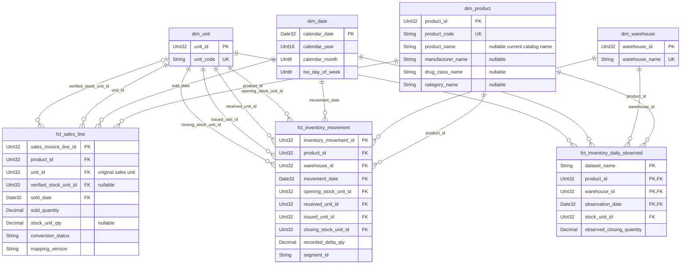

# Star schema

The warehouse implements four conformed dimensions and three facts in ClickHouse database `inventory_dw`. All keys retain their source meaning: product, warehouse and unit dimensions reuse the numeric OLTP identities; the calendar uses `Date32` dates. Invoice, document, batch, dataset and source-row references preserve lineage without creating unsupported relationships.

## Models and materialization

All seven mart models are full-refresh `MergeTree()` tables without calendar partitioning. Their definitions and complete typed column contracts are maintained beside the SQL in [dimension schemas](../../transform/dbt/models/marts/dimensions/_dimensions.yml), [sales schema](../../transform/dbt/models/marts/sales/_sales.yml) and [inventory schemas](../../transform/dbt/models/marts/inventory/_inventory.yml).

| Model | Grain / primary key | Source | Sorting key |
|---|---|---|---|
| `dim_product` | Current product / `product_id` | Product staging and manufacturer, drug class, category lookups | `product_id` |
| `dim_warehouse` | Current warehouse / `warehouse_id` | Warehouse staging | `warehouse_id` |
| `dim_unit` | Source unit label / `unit_id` | Unit staging | `unit_id` |
| `dim_date` | Calendar day / `calendar_date` | Complete years covering sales and inventory staging event dates | `calendar_date` |
| `fct_sales_line` | Original sales line / `sales_invoice_line_id`; alternate `(dataset_name,dataset_row_number)` | `int_sales_quantity_converted` | `(dataset_name,product_id,sold_date,sales_invoice_line_id)` |
| `fct_inventory_movement` | Original movement / `inventory_movement_id`; alternate source composite | `int_inventory_segments` | `(dataset_name,product_id,warehouse_id,movement_date,dataset_row_number)` |
| `fct_inventory_daily_observed` | `(dataset_name,product_id,warehouse_id,observation_date)` | Movement fact | Composite daily grain |

ClickHouse sort/primary indexes do not enforce uniqueness or FKs; dbt acceptance tests enforce these contracts. Full rebuilds incorporate only the raw state supplied by extraction. Run extraction and dbt sequentially, and expose downstream results after a successful build.

## Relationships



Diagram types are abbreviated; YAML contains the complete types and nullable definitions. Dimension-to-fact relationships are one-to-many. Required fact references have exactly one parent; the optional verified stock-unit role has zero or one. Analytical LEFT joins preserve unmatched facts for diagnosis, with `join_use_nulls=1`; required orphan keys fail acceptance. Never mask duplicate dimension keys with `ANY JOIN`.

| Dimension | Fact foreign-key roles |
|---|---|
| Product | `product_id` in all three facts |
| Warehouse | `warehouse_id` in the two inventory facts |
| Unit | Sales `unit_id` and optional `verified_stock_unit_id`; movement `opening_stock_unit_id`, `received_unit_id`, `issued_unit_id`, `closing_stock_unit_id`; daily `stock_unit_id` |
| Date | Sales `sold_date`, movement `movement_date`, daily `observation_date` → `calendar_date` |

No sales-to-warehouse or sales-to-movement relationship is defined. Product/date/unit provide shared analytical scopes; aggregate the two domains independently before comparing them. Do not join individual sales lines to inventory movements or label product-level sales as warehouse demand.

## Dimension contracts

- **Product:** nine columns: ID/DrugCode/name plus nullable manufacturer, drug-class and category IDs/labels. Product labels use Type 1 current catalog values. Facts retain transaction-recorded labels separately. No effective-dated attribute history is inferred.
- **Warehouse:** numeric ID and exact current source name. No geography, capacity or active-date fields are available.
- **Unit:** numeric ID and exact source label. `Fls`, `Btl`, `Botol`, `Box`, `Tab` and other labels are not assumed equivalent. The unit dimension contains no conversion factors; conversion remains product/version governed.
- **Date:** ten columns covering civil year/quarter/month/day, ISO weekday/week/year, month start and weekend flag. Complete-year coverage is derived from transaction event timestamps, including leap dates. An empty event source set produces an empty calendar. Shift and expiry dates remain descriptors and do not define calendar coverage or event-date FKs.

Optional product attributes and unsupported stock-unit references remain NULL. Required product/unit/warehouse/date references must resolve; no synthetic zero/Unknown entity or fabricated quantity is substituted. Presentation labels may describe missing classifications without changing identity.

Numeric IDs are durable within the preserved OLTP instance. A new bootstrap may assign different IDs and requires a coordinated rebuild of raw, dimensions and facts. DrugCode remains a unique alphanumeric business key; it is the mapping seed's `product_id`, distinct from the numeric `product_id` in dimensions/facts. Source row numbers order this verified export; they are neither generated identity IDs nor extraction watermarks. Independent dataset namespaces do not automatically deduplicate overlapping business transactions.

## Sales fact

`fct_sales_line` explicitly projects all **57 upstream columns**, preserving values, order, types and nullability. It contains no dimension joins or new key generation. Original quantity/unit, timestamp/shift, transaction product labels, optional batch, all financial fields, payment/cashier attributes, UOM status, factors and provenance pass through unchanged. Full type definitions are in the [sales YAML](../../transform/dbt/models/marts/sales/_sales.yml).

Only `identity` and `approved` status quantities can be compared with compatible recorded stock. Candidate, quarantined and unmapped quantities/factors stay NULL. Each build selects one explicitly pinned published mapping version; version selection does not multiply the original sales-line grain. Existing UOM governance and exact decimal arithmetic remain authoritative.

Sales lack verified completion/cancellation, sales-return matching, warehouse allocation and currency/fee-allocation contracts. Keep fees and percentages on the source line without certifying invoice totals or revenue. Invoice number plus product is not a unique line key. Optional batch identity includes product and expiry; batch number alone is not unique. Inventory has no verified batch reference.

## Inventory and aggregation

Inventory facts preserve source ordering, gaps, segment anchors, quantity signs and observed daily closing selection. The date dimension adds calendar labels without filling missing observations. Full rules are in [historical inventory](../historical-inventory.md).

| Measure | Safe aggregation |
|---|---|
| Original sales quantity | Sum distinct lines within the same product and original unit; retain dataset scope |
| Converted stock-unit quantity | Sum accepted conversions within product and verified unit, with one version and explicit unresolved coverage; never turn NULL into zero |
| Recorded line amount/discount/subtotal | Recorded-field totals only within a known consistent monetary scope; not certified net revenue/invoice totals |
| Fees, unit price, percentages, print count, conversion/evidence ratios | No unqualified sum; fees need an allocation contract before business totals |
| Received, issued, recorded delta | Sum disjoint movements/days in compatible product/unit scopes; delta is actual receipts minus issues |
| Opening/closing stock | Semi-additive: never sum successive observations across time. Warehouse sums require compatible units and disclosed observation timing/coverage |
| Continuity delta | Diagnostic only; never add to movement flows |
| Movement/discontinuity count | Additive across disjoint native grains; daily flags count affected days, movement flags count movements |
| Distinct segment/unit/invoice counts | Recompute at the reporting grain; do not sum repeated distinct counts |

A compatible product-level comparison requires independently aggregated sales and inventory by dataset/product/date/unit. Expose warehouse observation timestamps and unresolved sales coverage. An absent day is not zero demand or zero stock; calendar-day velocity, Days of Supply, forecasts and replenishment decisions require additional observation/feature contracts. Final-export ordering and Type 1 catalogs do not establish historical arrival/correction knowledge or physical availability.

## Quality checks and execution

Run from the repository root after OLTP extraction:

```bash
uv run --locked dbt build --project-dir transform/dbt --profiles-dir transform/dbt \
  --vars '{"uom_mapping_version":"uom_mapping_v2_2026-11-08"}'
uv run --locked python tests/marts/integration.py
```

- Dimension PK/business-key uniqueness and non-nullness; exact master row/attribute preservation and nullable catalog consistency.
- Exact declared names, types and column order on the five dimensional/sales models; unexpected fields such as a sales warehouse column fail.
- Complete calendar bounds/coverage/attributes and all fact event-date relationships.
- Sales source grain and complete NULL-aware preservation of all 57 upstream fields; selected version/status/NULL guards.
- Required and non-null optional FKs for all three facts; per-fact grain after every dimension JOIN.
- Native dbt fixtures for missing catalog values/unmatched products, leap/ISO boundaries, empty sources and precise signed/zero sales fields.
- Disposable ClickHouse regression verifies that orphan references, duplicate-dimension fan-out, NULL-to-zero changes and schema additions are rejected.
- Existing normalization, Historical Inventory, source sequence and UOM regression tests remain in use. See [tests](../../tests/README.md) for the complete suite.

Snapshot reconciliation currently covers **649,656 sales lines**, **804,027 movements**, **496,938 daily observations**, **188 gaps** and **8,335 segments**. Dimensions contain **4,385 products**, **2 warehouses**, **20 units** and **1,096 dates** (2023-01-01–2025-12-31). These are current export results, not hardcoded test constraints. New dimension coverage does not alter inventory observations or conversion decisions.

[Architecture](../architecture.md) · [UOM governance](../uom.md) · [Source sequence](../source-sequence-integrity.md)
