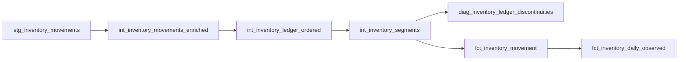

# Historical observed inventory

The inventory models reconstruct recorded observations in the supplied export. They preserve every movement and source identifier, use the validated export sequence within each dataset/product/warehouse ledger, and expose discontinuities and negative observations without repairing them. Results are not certified physical stock, available stock or point-in-time knowledge.

## Models and grains

| Model | Grain | Behavior |
|---|---|---|
| `int_inventory_movements_enriched` | One source movement | Adds labels, `recorded_delta_qty`, and quality flags while retaining source values |
| `int_inventory_ledger_ordered` | One source movement | Adds the preceding observation and continuity check in source sequence |
| `int_inventory_segments` | One movement assigned to a segment | Starts a segment at ledger start or a gap; reconstructs closing from its recorded opening and flows |
| `diag_inventory_ledger_discontinuities` | One observed gap | Provides adjacent rows and conservative description labels |
| `fct_inventory_movement` | One source movement | Preserves source fields and adds date, segment membership and diagnostics |
| `fct_inventory_daily_observed` | Dataset × product × warehouse × observed date | Aggregates recorded flows and selects a coherent final source observation |

`dataset_row_number` is the verified export ordering key. PostgreSQL identity IDs are not used to order the ledger. A segment key encodes dataset, product, warehouse and its starting source sequence. Segment arithmetic uses `Decimal(38,6)` while source quantities remain `Decimal(18,6)`.

Daily closing fields are selected together from the same row using maximum source sequence. All movements contribute to daily counts, flow sums and quality flags. Units are checked within movements and across each export ledger. Daily flows use `Decimal(38,6)`. Unobserved dates remain absent.

## Reconciliation snapshot

Validated against `pharmacy_2023_2025` on 2026-11-08. These figures describe this dataset only.

| Check | Result |
|---|---:|
| Movements / unique movement IDs | 804,027 / 804,027 |
| Product–warehouse ledgers | 8,147 |
| Continuous / discontinuous transitions | 795,692 / 188 |
| Segments | 8,335 |
| Segment reconstruction errors | 0 |
| Daily observed rows / unique grains | 496,938 / 496,938 |
| Daily movement count total | 804,027 |
| Conflicting latest-time daily groups | 144 |
| Negative movement closing / negative daily closing observations | 2,180 / 30 |
| UNKNOWN movements | 22,104 |
| RETURN with inbound / outbound direction | 803 / 33 |

All movement balance equations reconcile at the source precision. Reconciliation tests independently check row preservation, predecessor selection, segment anchors and ranges, exact arithmetic, daily grain, selected observations, units and quality flags. Source-order lineage is fully compared across six layers in [sequence integrity evidence](source-sequence-integrity.md).

## Interpretation limits

The 188 gaps are preserved observations. Description keywords are diagnostic labels and do not establish stocktake batches or cancellation rules. The sum of a segment is an internal reconstruction check, not independent evidence of physical inventory. Latest-timestamp conflicts remain flagged; daily selection follows export sequence. Missing dates are not zero-filled or carried forward. Historical arrival/correction times, inventory availability, reservation/allocation history and sales warehouse assignment are not available from this export.

The inventory ledger, segment table and two facts are rebuilt as ClickHouse tables on dbt runs. Incremental segment maintenance is not used. Run extraction and dbt sequentially and read downstream results after a successful build. Current Python and dbt validation commands are in the [main README](../README.md).
