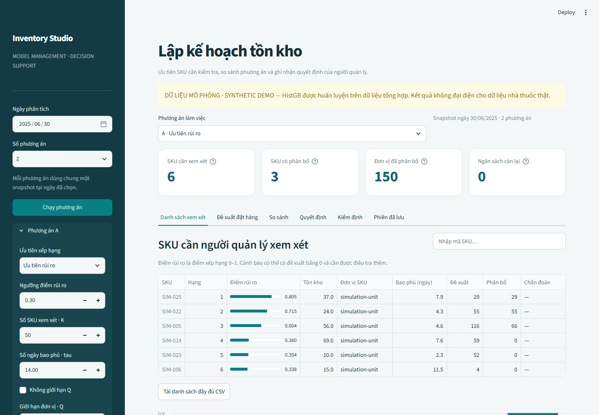

# Inventory Studio

The Streamlit dashboard provides a Vietnamese manager workflow for MMS. It
uses the same services as the CLI; changing a widget never invokes ETL or dbt.



## Start locally

The already generated trained demonstration is available at:

```powershell
uv run --locked --extra ui streamlit run reports/mms-trained-demo/app.py --server.address 127.0.0.1 --server.port 8501
```

Open http://127.0.0.1:8501. If the generated directory does not exist after
cloning, run `inventory-mms bootstrap-demo --output reports/mms-trained-demo
--seed 7` with the MMS/UI extra first; see [the integration guide](mms-production.md).
The trained app prominently identifies its simulation data. The real downloaded
source files and available-stock approval remain separate concerns.

For environment-configured sources, run
`streamlit run src/inventory_dw_dss/mms/ui.py`; existing DuckDB/ClickHouse settings
and the injected-runtime embedding interface are preserved.

## Workflow

1. Select the analysis date and 1–4 scenarios in the sidebar. Each has its own
   ranking profile, risk threshold, K, target coverage and unit budget Q.
2. Click **Chạy phương án**. All compared plans use one snapshot and risk vector.
   Select the working scenario above the four summary cards.
3. **Danh sách xem xét** includes investigation alerts even when suggested q=0.
   Search affects the displayed table; the clearly labelled full-list CSV exports
   the original plan, with date/profile in its filename.
4. **Đề xuất đặt hàng** contains eligible positive allocations and shows Q use.
   Q denotes product-specific units, not money or a purchasing-cost estimate.
5. **So sánh** shows quantities, constraints and pairwise SKU overlap. Risk scores
   are displayed on a 0–1 scale, without implying calibrated probabilities.
6. **Quyết định** records accepted/rejected/edited/pending actions. A note may be
   saved while the item is still pending. Bulk approval only marks rows with
   positive allocated quantities; it never submits a purchase order.
7. **Kiểm định** runs independent 7/14/30-day outcome windows, displays per-date
   status/metrics and keeps the report through ordinary widget reruns. The report
   states the horizon that was actually evaluated, even if controls are edited.
8. **Phiên đã lưu** reopens exact results, configuration, actions and notes. A
   historical follow-up checks data-version compatibility before reading observations.

Changing scenario controls marks the old plan as stale and disables saving or
evaluation until rerun. Starting a new run clears manager drafts; switching
between scenarios in the same run preserves drafts outside widget lifecycles.
Drafts are session-local: click **Lưu quyết định** for durable SQLite storage.
Switching data sources/releases/artifacts clears old comparison and manager state.

Empty and zero-budget lists remain valid tables. Undefined historical metrics
appear as blank/“—”, not zero. Optional details expose reproducibility metadata
and JSON downloads without putting raw payloads in the primary workflow.

## Layout and verification

Desktop uses a teal parameter sidebar, light metric cards, risk/quantity charts
and native tables. At mobile widths, metric cards form a two-column grid and the
sidebar collapses. Tables retain their own horizontal scrolling.

The UI/presenter/tracking checks cover source switches, stale parameters, pending
notes, persisted backtests, per-scenario manager drafts, zero budgets and numeric
CSV preservation. Text cells are escaped for spreadsheet formulas; numeric
negative stock remains numeric. Browser QA used a fresh headless Chrome session
against the local trained app after the integrated browser reported no connected
browser. Desktop/mobile screenshots showed no page errors or mobile page overflow.
