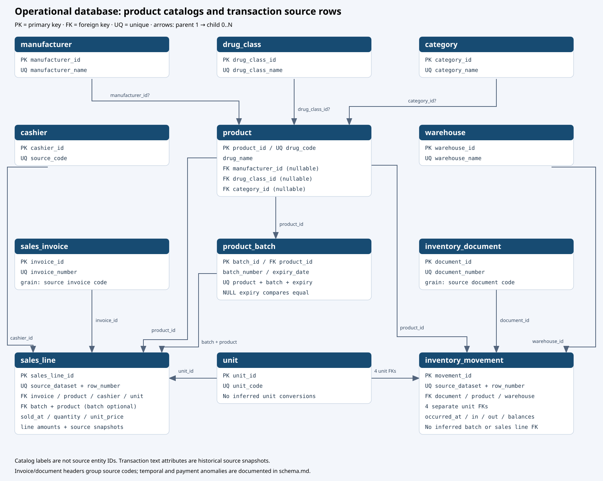

# Mô hình operational database

Đây là schema nguồn giao dịch cho kiến trúc `OLTP → Extraction → ClickHouse → dbt → Data Marts → DSS`. Các thao tác chuẩn bị CSV và tạo database dưới đây thuộc [bootstrap tùy chọn](ingestion.md); DW vận hành đọc bảng `oltp.*` bằng kết nối database, không đọc CSV hoặc gọi bootstrap. Compose chạy PostgreSQL và ClickHouse; Python extraction và dbt chạy qua `uv`. Pipeline sao chép 12 bảng OLTP sang ClickHouse raw, rồi dbt tạo 12 staging view. Mô hình chiều, marts và DSS chưa được triển khai. Xem [pipeline extraction](../extraction.md).

Database PostgreSQL tái dựng giao dịch POS từ hai CSV, gồm **12 bảng OLTP** và một bảng metadata lịch sử. Hai bảng staging raw chỉ còn là snapshot lịch sử trên database cũ; bootstrap mới không tạo chúng. Toàn bộ schema hiện hành nằm trong một [tệp DDL idempotent](../../sql/oltp/schema.sql), nhóm theo shared entities, sales, inventory và catalog enrichment. Các khối SQL dưới đây mô tả cấu trúc; để triển khai, dùng loader thay vì chạy riêng từng khối.

## 1. Mức chi tiết và quan hệ

| Bảng giao dịch | Một dòng đại diện cho | Khóa nhận diện nguồn |
|---|---|---|
| `sales_line` | Một dòng hàng trên hóa đơn bán | `(source_dataset, source_row_number)` |
| `inventory_movement` | Một dòng biến động nguồn của sản phẩm tại kho và thời điểm ghi nhận; không suy ra lô | `(source_dataset, source_row_number)` |

Các header hiện là nhóm theo mã nguồn; chưa chứng minh mọi mã tương ứng duy nhất một giao dịch nghiệp vụ ngoài hệ thống nguồn.



Sơ đồ hiển thị khóa và các thuộc tính chính. Mỗi FK khác NULL trên bảng con tham chiếu đúng một dòng cha; bảng cha có thể có 0 hoặc nhiều dòng con. PK là khóa chính, FK là khóa ngoại, UQ là khóa duy nhất.

| Cha | Con | FK trên bảng con |
|---|---|---|
| `manufacturer` | `product` | `manufacturer_id`, nullable |
| `drug_class` | `product` | `drug_class_id`, nullable |
| `category` | `product` | `category_id`, nullable |
| `product` | `product_batch` | `product_id` |
| `product` | `sales_line`, `inventory_movement` | `product_id` |
| `product_batch` | `sales_line` | `(batch_id, product_id)`, batch tùy chọn |
| `sales_invoice` | `sales_line` | `invoice_id` |
| `cashier` | `sales_line` | `cashier_id` |
| `unit` | `sales_line` | `unit_id` |
| `unit` | `inventory_movement` | `initial_unit_id`, `in_unit_id`, `out_unit_id`, `remaining_unit_id` |
| `warehouse` | `inventory_movement` | `warehouse_id` |
| `inventory_document` | `inventory_movement` | `document_id` |

Không có FK trực tiếp nối dòng bán với biến động kho. Chỉ trùng mã hóa đơn/chứng từ chưa đủ để chứng minh ánh xạ từng dòng.

## 2. Quyết định thiết kế

- **Loại trừ đã chốt:** không thêm `PrescriptionNumber`, `PatientID`, `SalespersonID`, `TaxInvoiceNumber` vào OLTP. Các giá trị vẫn còn ở raw/staging lịch sử; chúng nằm ngoài phạm vi thuộc tính nguồn OLTP cho DW.

- **Phạm vi sales đã chốt:** các trường chưa chắc thuộc invoice (`service_fee`, `packaging_fee`, `additional_fee`, `promo_discount_pct`, `tax_pct`, `is_member`) giữ tại `sales_line`. Khác biệt giữa các dòng không tự chứng minh đó là phí riêng của sản phẩm. `sold_at`, ca, thu ngân và thanh toán cũng giữ trên line vì có bất thường trong cùng mã invoice.
- **Khóa:** PK của các bảng OLTP là bigint identity. Các mã danh mục/hóa đơn/chứng từ là natural key UNIQUE. Identity có thể có khoảng trống, không dùng làm thứ tự thời gian hoặc số đếm bản ghi.
- **Lô:** sales_line giữ product_id bắt buộc ngay cả khi không có lô. Batch hợp lệ được thêm trước khi upsert dòng bán. FK ghép ngăn gán lô của sản phẩm khác; không sinh lô giả cho chuỗi trống.
- **Danh mục và snapshot:** product giữ tên và ba FK danh mục; cả 4 thuộc tính nhất quán theo DrugCode trên dữ liệu hiện có. Tên/hãng/phân loại trên giao dịch là snapshot nguồn, giữ để truy nguyên. Chúng không phải khóa danh mục. Một giá trị đã biết mâu thuẫn với master sẽ chặn load; không tự chọn hãng mới hoặc suy ra lịch sử hiệu lực. Mô tả, ca và thông tin thanh toán vẫn giữ trên dòng. Mô hình có lặp snapshot có chủ đích, chưa khẳng định đạt 3NF đầy đủ.
- **Kiểu số:** dùng numeric để giữ số thập phân; pandas giữ chuỗi số chuẩn khi xuất, tránh làm tròn tiền qua float. Tỷ lệ lưu 0–100, `TaxAmount` ánh xạ thành tax_pct vì nguồn là phần trăm. Không có quy đổi đơn vị hoặc đơn vị tiền tệ được bổ sung theo suy đoán.
- **Thời gian:** timestamp không múi giờ vì CSV không có offset. Các thành phần năm/tháng/ngày/giờ được xuất trong processed; OLTP chỉ cần timestamp và các thuộc tính ca riêng.
- **Thiếu dữ liệu:** dấu `-` trong hãng/phân loại chuyển thành NULL ở OLTP; raw còn nguyên. Trường tùy chọn không parse được là NULL kèm cảnh báo preparation; trường bắt buộc lỗi sẽ chặn prepare.
- **Tồn kho:** giữ tồn âm như raw. Chưa đặt CHECK cân đối tồn hoặc công thức tiền vì chưa xác minh các quy tắc nghiệp vụ. Không cộng remaining_stock qua nhiều thời điểm.
- **Xóa:** FK dùng NO ACTION mặc định, không xóa dây chuyền. Upsert không xóa các dòng vắng mặt trong lần nạp.

## 3. Schema từng bảng

PK ngầm NOT NULL; cột không ghi NOT NULL có thể chứa NULL. Các ví dụ DDL mô tả schema hiệu lực.

### 3.1. `oltp.product`

Một dòng là một mã sản phẩm, dùng chung cho sales và stock. Mã là natural key UNIQUE; PK tự tăng dùng cho FK. Tên và ba FK danh mục cho phép NULL khi nguồn thiếu. 4.385 mã chỉ có 4.384 tên khác nhau nên tên không phải khóa. Trong database đã backfill, có 527 sản phẩm biết hãng, 29 biết DrugClass và 2.728 biết Category; phần còn lại giữ NULL.

```sql
CREATE TABLE oltp.product (
 product_id bigint GENERATED ALWAYS AS IDENTITY PRIMARY KEY,
 drug_code text NOT NULL UNIQUE,
 drug_name text,
 manufacturer_id bigint REFERENCES oltp.manufacturer,
 drug_class_id bigint REFERENCES oltp.drug_class,
 category_id bigint REFERENCES oltp.category
);
```

### 3.2. `oltp.warehouse`

Một dòng là một kho/địa điểm ghi nhận tồn, giữ nguyên ranh giới Apotek và Gudang Obat 1.

```sql
CREATE TABLE oltp.warehouse (
 warehouse_id bigint GENERATED ALWAYS AS IDENTITY PRIMARY KEY,
 warehouse_name text NOT NULL UNIQUE
);
```

### 3.3. `oltp.unit`

Một dòng là một đơn vị tính nguồn. Không tự suy diễn hệ số quy đổi giữa các đơn vị.

```sql
CREATE TABLE oltp.unit (
 unit_id bigint GENERATED ALWAYS AS IDENTITY PRIMARY KEY,
 unit_code text NOT NULL UNIQUE
);
```

### 3.4. `oltp.cashier`

Một dòng là một mã thu ngân đã ẩn danh.

```sql
CREATE TABLE oltp.cashier (
 cashier_id bigint GENERATED ALWAYS AS IDENTITY PRIMARY KEY,
 source_code text NOT NULL UNIQUE
);
```

### 3.5. `oltp.sales_invoice`

Một dòng là một nhóm dòng có cùng mã hóa đơn nguồn. 223 mã có nhiều thời điểm, 222 mã khác ca/thu ngân và 5 mã khác PaymentType. Vì vậy không chọn một thời điểm/ca/thu ngân/thanh toán bất kỳ cho header. InvoiceDiscountPct và PrintCount nhất quán trong từng mã, là ứng viên đưa về header; hiện vẫn lưu tại sales_line. Các bất thường chưa đủ để tách hóa đơn thành nhiều header tự động.

```sql
CREATE TABLE oltp.sales_invoice (
 invoice_id bigint GENERATED ALWAYS AS IDENTITY PRIMARY KEY,
 invoice_number text NOT NULL UNIQUE
);
```

### 3.6. `oltp.product_batch`

Một dòng là một bộ sản phẩm–mã lô–hạn dùng. UNIQUE NULLS NOT DISTINCT ngăn tạo nhiều lô trùng khi hạn dùng NULL. Cùng mã lô ở sản phẩm hoặc hạn dùng khác nhau là bộ khác. Chuỗi raw vẫn có trong sales_line để truy nguyên.

```sql
CREATE TABLE oltp.product_batch (
 batch_id bigint GENERATED ALWAYS AS IDENTITY PRIMARY KEY,
 product_id bigint NOT NULL REFERENCES oltp.product,
 batch_number text NOT NULL,
 expiry_date date,
 CONSTRAINT product_batch_natural_key UNIQUE NULLS NOT DISTINCT (product_id, batch_number, expiry_date),
 CONSTRAINT product_batch_product_key UNIQUE (batch_id, product_id)
);
```

### 3.7. `oltp.sales_line`

Một dòng tương ứng một dòng nguồn sales. product_id bắt buộc; batch_id có thể NULL khi thiếu lô. FK ghép bảo đảm batch_id thuộc đúng product_id. source_dataset và source_row_number là khóa upsert; sales_line_id giữ nguyên khi cập nhật.

```sql
CREATE TABLE oltp.sales_line (
 sales_line_id bigint GENERATED ALWAYS AS IDENTITY PRIMARY KEY,
 source_row_number bigint NOT NULL,
 invoice_id bigint NOT NULL REFERENCES oltp.sales_invoice,
 product_id bigint NOT NULL REFERENCES oltp.product,
 unit_id bigint NOT NULL REFERENCES oltp.unit,
 cashier_id bigint NOT NULL REFERENCES oltp.cashier,
 sold_at timestamp NOT NULL,
 shift text,
 drug_name text NOT NULL,
 manufacturer text, drug_class text, category text,
 batch_and_expiry_date text,
 quantity numeric NOT NULL, unit_price numeric NOT NULL,
 price_tier text, discount_pct numeric, discount_amount numeric,
 service_fee numeric, packaging_fee numeric, subtotal numeric,
 invoice_discount_pct numeric, promo_discount_pct numeric,
 tax_pct numeric, additional_fee numeric, total_price numeric,
 payment_type text, print_count integer,
 is_member text,
 source_dataset text NOT NULL DEFAULT 'pharmacy_2023_2025',
 batch_id bigint,
 shift_date date,
 shift_period text,
 shift_cashier_code text,
 price_tier_number integer,
 CONSTRAINT sales_line_source_key UNIQUE (source_dataset, source_row_number),
 CONSTRAINT sales_line_batch_product_fk FOREIGN KEY (batch_id, product_id)
 REFERENCES oltp.product_batch (batch_id, product_id)
);
```

### 3.8. `oltp.inventory_document`

Một dòng là một mã chứng từ nguồn; chưa khẳng định là một sự kiện tại một kho hoặc một thời điểm. Có 8.528 mã trải qua nhiều kho và 179.466 mã có nhiều thời điểm. Chứng từ có thể thuộc bán, mua, chuyển kho hoặc kiểm kê; các thuộc tính đó giữ trên movement khi chưa xác nhận tính nhất quán.

```sql
CREATE TABLE oltp.inventory_document (
 document_id bigint GENERATED ALWAYS AS IDENTITY PRIMARY KEY,
 document_number text NOT NULL UNIQUE
);
```

### 3.9. `oltp.inventory_movement`

Một dòng tương ứng một biến động sản phẩm tại một kho trong stock raw. Bốn số lượng giữ bốn FK đơn vị riêng. Mô tả raw và thông tin được tách cùng tồn tại. Không gán batch hoặc sales_line_id vì nguồn chưa có ánh xạ chắc chắn.

```sql
CREATE TABLE oltp.inventory_movement (
 movement_id bigint GENERATED ALWAYS AS IDENTITY PRIMARY KEY,
 source_row_number bigint NOT NULL,
 document_id bigint NOT NULL REFERENCES oltp.inventory_document,
 product_id bigint NOT NULL REFERENCES oltp.product,
 warehouse_id bigint NOT NULL REFERENCES oltp.warehouse,
 occurred_at timestamp NOT NULL,
 drug_name text NOT NULL, drug_class text, category text,
 drug_type text, status text, description text,
 initial_stock numeric NOT NULL, stock_in numeric NOT NULL,
 stock_out numeric NOT NULL, remaining_stock numeric NOT NULL,
 initial_unit_id bigint NOT NULL REFERENCES oltp.unit,
 in_unit_id bigint NOT NULL REFERENCES oltp.unit,
 out_unit_id bigint NOT NULL REFERENCES oltp.unit,
 remaining_unit_id bigint NOT NULL REFERENCES oltp.unit,
 source_dataset text NOT NULL DEFAULT 'pharmacy_2023_2025',
 transaction_type text,
 supplier_name text,
 referenced_invoice_number text,
 patient_code text,
 CONSTRAINT inventory_movement_source_key UNIQUE (source_dataset, source_row_number)
);
```

### 3.10. `oltp.manufacturer`

Một dòng là một nhãn hãng khác rỗng đã quan sát trong sales. Nguồn không có mã hãng pháp lý, nên không khẳng định hai tên khác nhau là hai pháp nhân khác nhau. Stock không có hãng; không tự điền khi chưa có sales cùng mã sản phẩm.

```sql
CREATE TABLE oltp.manufacturer (
 manufacturer_id bigint GENERATED ALWAYS AS IDENTITY PRIMARY KEY,
 manufacturer_name text NOT NULL UNIQUE
);
```

### 3.11. `oltp.drug_class`

Một dòng là một nhãn DrugClass khác rỗng; không suy diễn thành nhóm điều trị/dược lý.

```sql
CREATE TABLE oltp.drug_class (
 drug_class_id bigint GENERATED ALWAYS AS IDENTITY PRIMARY KEY,
 drug_class_name text NOT NULL UNIQUE
);
```

### 3.12. `oltp.category`

Một dòng là một nhãn Category khác rỗng. Category và DrugClass độc lập trong schema: chưa có bằng chứng về quan hệ phân cấp bắt buộc giữa chúng.

```sql
CREATE TABLE oltp.category (
 category_id bigint GENERATED ALWAYS AS IDENTITY PRIMARY KEY,
 category_name text NOT NULL UNIQUE
);
```

Ba danh mục dùng trim và xem chuỗi rỗng/`-` là thiếu; không gộp nhãn theo fuzzy matching hoặc tạo dòng Unknown giả. Product có thể NULL FK. Migration 004 backfill từ giao dịch hiện có; các lần load sau bổ sung từ dữ liệu được chọn, kiểm tra mâu thuẫn với master và giữ giá trị đã biết nếu nguồn mới thiếu.

### 3.13. `staging.schema_migration`

Bảng metadata lưu phiên bản và SHA-256 đã áp dụng bởi loader cũ, cùng marker cho lần backfill danh mục được nhúng trong schema hiện tại. Loader không còn đọc migration file; schema hiệu lực được định nghĩa tập trung trong `sql/oltp/schema.sql`.

```sql
CREATE TABLE staging.schema_migration (
 version text PRIMARY KEY,
 sha256 text NOT NULL,
 applied_at timestamptz NOT NULL DEFAULT now()
);
```

## 4. Granularity và giới hạn nguồn

Sales có 359.121 mã hóa đơn; 223 mã khác thời gian giữa dòng, 222 khác ca/thu ngân và 5 khác PaymentType. Vì vậy header nhóm theo mã nguồn, không tự chọn một thời điểm/ca/thanh toán chung. InvoiceDiscountPct và PrintCount nhất quán trong từng invoice, nhưng hiện vẫn được lưu trên line. Phí khác nhau giữa dòng chưa chứng minh là phí riêng của sản phẩm hay phí chung được ghi/phân bổ vào một dòng.

Stock có 404.180 mã chứng từ; 179.466 mã có nhiều thời điểm, 8.528 có nhiều kho, 901 khác mô tả và 1.550 khác DrugType. Các thuộc tính đó giữ trên movement. Số dư đầu/cuối không cộng qua thời gian; chỉ tổng hợp nhập/xuất khi cùng đơn vị hoặc có quy đổi đã xác minh.

Khóa master/header hiện thuộc phạm vi một hệ thống nguồn. Namespace source_dataset trên chi tiết không tự cô lập mã master/header giữa hai POS độc lập. Chưa có ánh xạ chắc chắn theo dòng giữa sales và stock, hoặc batch cho stock.

Sales ánh xạ 28/35 trường raw; stock ánh xạ 15/15 trường. Bốn trường có dữ liệu đã được quyết định loại trừ ở trên. DoctorID, SalesPromo, PromoName toàn bộ trống và chưa ánh xạ. Các thành phần ngày/giờ tính lại từ timestamp, không cần lưu thêm cột vật lý. Xem [từ điển dữ liệu](data-dictionary.md) cho đủ 50 trường nguồn và [hướng dẫn ingestion](ingestion.md) cho parsing, schema, CLI và kiểm chứng.
