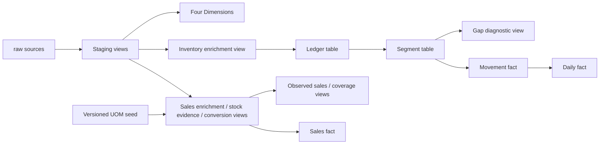

# dbt transformations

This project turns ClickHouse raw records into tested sales and inventory interfaces. dbt renders SQL, orders models by dependencies, creates views/rebuilds tables and runs data and unit tests. It does not extract from PostgreSQL or read the original transaction CSVs.

## Layers and dependencies

| Layer | Purpose | Materialization / guide |
|---|---|---|
| Raw | Current extracted records, stored as source text | External tables declared in [_sources.yml](models/staging/_sources.yml) |
| Staging | Strict types, consistent names and missing-value normalization, same source grain | [12 views](models/staging/README.md) |
| Intermediate | Reusable sales/UOM and inventory business calculations | [Seven views and two full-rebuild tables](models/intermediate/README.md) |
| Marts | Four shared Dimensions and three source-preserving Facts | [Seven full-rebuild tables](models/marts/README.md) |

`{{ source('raw', 'sales_line') }}` resolves a declared raw table. `{{ ref('stg_sales_invoice_lines') }}` resolves another model by name, independent of its SQL directory. Both register dependencies; `ref()` also lets dbt build parents before children. Model YAML describes business fields, types and tests. [Macros](macros/README.md) centralize normalization and version validation; [seeds](seeds/README.md) contain governed mapping inputs.



Facts reuse source keys; they do not join Dimensions during materialization. Relationship tests link those roles. A fact-only ancestor selection does not build Dimensions automatically.

## One record through the layers

An illustrative raw sales row stores quantity `'2.000000'`, a numeric product ID as text and an original unit ID. Staging parses the ID and Decimal quantity; enrichment adds the product's DrugCode and unit label Box. Conversion compares that unit with stock evidence across the product/export. If the verified stock unit is Tab and the selected mapping approves factor 10, `stock_unit_qty` becomes 20 Tab. Otherwise it remains NULL unless verified identity applies. `fct_sales_line` copies all 57 conversion columns, including the original 2 Box and provenance. No warehouse is inferred.

## Running and selecting models

All commands below run from the repository root, after extraction completes:

```bash
uv run --locked dbt debug --project-dir transform/dbt --profiles-dir transform/dbt
uv run --locked dbt parse --project-dir transform/dbt --profiles-dir transform/dbt
uv run --locked dbt compile --project-dir transform/dbt --profiles-dir transform/dbt --vars '{"uom_mapping_version":"uom_mapping_v2_2026-11-08"}'
uv run --locked dbt build --project-dir transform/dbt --profiles-dir transform/dbt --vars '{"uom_mapping_version":"uom_mapping_v2_2026-11-08"}'
# Sales ancestors plus its conformed Dimensions:
uv run --locked dbt build --select +fct_sales_line dim_product dim_unit dim_date --project-dir transform/dbt --profiles-dir transform/dbt --vars '{"uom_mapping_version":"uom_mapping_v2_2026-11-08"}'
# Tests against an already built model:
uv run --locked dbt test --select fct_sales_line --project-dir transform/dbt --profiles-dir transform/dbt --vars '{"uom_mapping_version":"uom_mapping_v2_2026-11-08"}'
```

`+model` selects ancestors; `model+` selects descendants; `staging` selects that model directory. Cross-model tests can read unselected relations, which must exist and be current. Use full builds for broad source changes and acceptance. `state:modified` detects code/config changes, not changed raw rows. Compilation checks rendering, not row preservation or correct measures. [Test instructions](../../tests/README.md) explain failure diagnosis.

## Views, tables and refresh boundaries

Views reflect current upstream tables when queried, not when created. Ledger, segments, Dimensions and Facts persist rows and require a rebuild. Full table rebuilds are intentional: changed predecessor rows can split/merge segments and affect later rows, and new inventory evidence or a new mapping version can change historical sales conversion. No incremental dbt materialization is implemented. Full rebuilds are retained because inventory predecessor and segment changes can affect later ledger rows, while changed stock-unit evidence or UOM mapping versions can alter historical sales conversions. The current full-build runtime has been measured at roughly 30 seconds for 324 dbt nodes on the development dataset; the dataset does not currently justify the invalidation and recovery complexity of incremental tables.

Table replacements are published per relation; a full build is not one database transaction. Keep extraction and dbt sequential, keep the seed stable while readers use conversion views, and release DSS consumption only after successful complete validation. Rerun the affected chain after a failure; do not treat old and newly rebuilt facts as one accepted release.

## UOM versions and configuration

`dbt_project.yml` sets model folders, default view/table materializations, seed types, NULL-preserving JOIN settings and the default UOM version. `profiles.yml` supplies the ClickHouse endpoint, schema and credentials through environment variables with local defaults; it can host profiles for other projects too. Profile name must match the project's `profile` key. `.user.yml` is generated local dbt state, not a project input.

Explicitly pin `uom_mapping_version` in builds and matching tests/analyses. The version literal is stored in the conversion view definition. Updating a seed or passing `--vars` only to a query does not recreate that view. New approvals require a new immutable reference snapshot, updated seed/publication tests and a rebuilt sales branch. Follow [UOM publishing](seeds/README.md); never overwrite a published version.

## Inspecting the graph and SQL

```bash
uv run --locked dbt ls --select +fct_sales_line --resource-type model --output name --project-dir transform/dbt --profiles-dir transform/dbt
uv run --locked dbt docs generate --project-dir transform/dbt --profiles-dir transform/dbt --vars '{"uom_mapping_version":"uom_mapping_v2_2026-11-08"}'
uv run --locked dbt docs serve --project-dir transform/dbt --profiles-dir transform/dbt --port 8080
```

The local docs site shows lineage and YAML descriptions. `target/manifest.json` records resolved dependencies, `target/compiled/inventory_dw/` contains rendered model/test SQL, `target/run_results.json` records actual statuses/timings, and `logs/dbt.log` contains executed SQL and exceptions. They are generated and ignored, not editable sources. Use the [model map](models/README.md) for a stable repository entry point.

## Extending safely

Define a new output grain first. Put reusable transformations in Intermediate and consumer-specific models in a clearly named Marts subfolder. Use `ref()` for parents, explicit columns/types and a companion YAML contract. Add uniqueness, relationships, row/measure reconciliation and business-boundary fixtures as appropriate. Build parents, new output and affected descendants with the version pinned, then run the full suite. Do not remove strict casts or overwrite NULL with zero to silence a failure. The [DSS guide](../../docs/dss-handover.md) provides worked maintenance scenarios.
