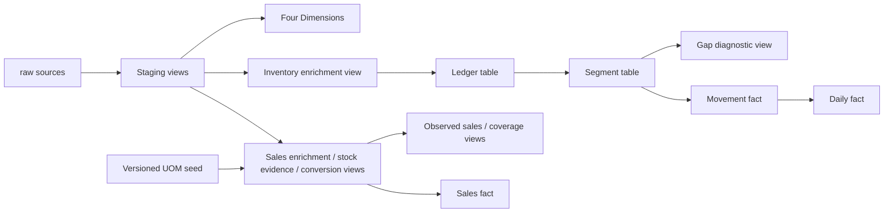

# dbt transformations

This project turns ClickHouse raw records into tested sales and inventory interfaces. dbt renders SQL, orders models by dependencies, creates views/rebuilds tables and runs data and unit tests. It does not extract from PostgreSQL or read the original transaction CSVs.

## Layers and dependencies

| Layer | Purpose | Materialization / guide |
|---|---|---|
| Raw | Current extracted records, stored as source text | External tables declared in [_sources.yml](models/staging/_sources.yml) |
| Staging | Strict types, consistent names and missing-value normalization, same source grain | [12 views](models/staging/README.md) |
| Intermediate | Reusable sales/UOM and inventory business calculations | [Seven views and two full-rebuild tables](models/intermediate/README.md) |
| Marts | Four shared Dimensions and three source-preserving Facts | [Seven full-rebuild tables](models/marts/README.md) |

`{{ source('raw', 'sales_line') }}` resolves a declared raw table. `{{ ref('stg_sales_invoice_lines') }}` resolves another model by name, independent of its SQL directory. Both register dependencies; `ref()` also lets dbt build parents before children. Model YAML describes business fields, types and tests. [Macros](macros/README.md) centralize normalization and version validation; [seeds](seeds/README.md) contain governed mapping inputs.



Facts reuse source keys; they do not join Dimensions during materialization. Relationship tests link those roles. A fact-only ancestor selection does not build Dimensions automatically.

## One record through the layers

An illustrative raw sales row stores quantity `'2.000000'`, a numeric product ID as text and an original unit ID. Staging parses the ID and Decimal quantity; enrichment adds the product's DrugCode and unit label Box. Conversion compares that unit with stock evidence across the product/export. If the verified stock unit is Tab and the selected mapping approves factor 10, `stock_unit_qty` becomes 20 Tab. Otherwise it remains NULL unless verified identity applies. `fct_sales_line` copies all 57 conversion columns, including the original 2 Box and provenance. No warehouse is inferred.

## Run transformations

Prerequisites: the local ClickHouse service is healthy and raw has been loaded successfully. Run from the repository root. The public command supplies the project/profile paths and uses the fixed `uom_mapping_version` in [dbt_project.yml](dbt_project.yml):

```bash
uv run --locked inventory-dw-dss transform
```

It delegates to dbt build: load the governed seed, create views, fully rebuild table models and execute data/unit tests. It does not load PostgreSQL or raw. A dbt failure returns a nonzero CLI exit code; already published relations are not rolled back as a group.

Run the complete transform once before targeted work. Selected checks can read existing unselected relations. For selected work and tests:

```bash
uv run --locked inventory-dw-dss transform --select staging
uv run --locked inventory-dw-dss transform --select +fct_sales_line dim_product dim_unit dim_date
uv run --locked inventory-dw-dss transform --test
uv run --locked inventory-dw-dss transform --test --select fct_sales_line
uv run --locked inventory-dw-dss transform --help
```

`--select` accepts one or more model/layer expressions. The public layer names `staging`, `intermediate`, `marts` and `dimensions` resolve to their repository paths; native model/path expressions pass through. `+MODEL` includes ancestors, `MODEL+` includes descendants. Selecting a fact's ancestors does not select its logical dimensions automatically, hence the sales example names them. A layer selection expects unselected parents to exist. Cross-model tests can also read unselected relations. Use the complete build for acceptance.

The default version is the explicit published value stored in the project, not a moving latest-version alias. To specify the publication explicitly (replace the example with another supported version when needed):

```bash
uv run --locked inventory-dw-dss transform --uom-version uom_mapping_v2_2026-11-08
```

Use the same version override with `--test`. The [coverage analyses](analyses/README.md) document their native dbt version option. Tests do not recreate an existing conversion view's stored version literal. `state:modified` is a dbt code/config selection concept; it does not detect raw data changes. [Test instructions](../../tests/README.md) explain regression order and failure diagnosis.

## Views, tables and refresh boundaries

Views query current upstream relations. Ledger, segments, dimensions and facts persist rows and require rebuilding. Full rebuilds are intentional: predecessor changes can alter later inventory segments, while stock-unit evidence or mapping changes can alter historical sales conversion. No incremental dbt materialization is configured. Complete builds have been measured at roughly 30 seconds for the current dataset and 324 dbt nodes; the project retains the simpler full-rebuild strategy.

Table replacements are published per relation; a full build is not one database transaction. Keep extraction and dbt sequential, keep the seed stable while readers use conversion views, and release DSS consumption only after successful complete validation. Rerun the affected chain after a failure; do not treat old and newly rebuilt facts as one accepted release.

## UOM versions and configuration

`dbt_project.yml` sets model folders, default view/table materializations, seed types, NULL-preserving JOIN settings and the default UOM version. `profiles.yml` supplies the ClickHouse endpoint, schema and credentials through environment variables with local defaults; it can host profiles for other projects too. Profile name must match the project's `profile` key. `.user.yml` is generated local dbt state, not a project input.

The wrapper uses the project-pinned `uom_mapping_version`; use `--uom-version` consistently when selecting a different publication. The version literal is stored in the conversion view definition. Updating a seed or selecting a different version only for a query does not recreate that view. New approvals require a new immutable reference snapshot, updated seed/publication tests and a rebuilt sales branch. Follow [UOM publishing](seeds/README.md); never overwrite a published version.

## Maintainer inspection

Normal operations use `transform`. Native dbt tools remain available for debugging, compilation, graph inspection and generated documentation:

```bash
uv run --locked dbt debug --project-dir transform/dbt --profiles-dir transform/dbt
uv run --locked dbt parse --project-dir transform/dbt --profiles-dir transform/dbt
uv run --locked dbt compile --project-dir transform/dbt --profiles-dir transform/dbt
uv run --locked dbt ls --select +fct_sales_line --resource-type model --output name --project-dir transform/dbt --profiles-dir transform/dbt
uv run --locked dbt docs generate --project-dir transform/dbt --profiles-dir transform/dbt --vars '{"uom_mapping_version":"uom_mapping_v2_2026-11-08"}'
uv run --locked dbt docs serve --project-dir transform/dbt --profiles-dir transform/dbt --port 8080
```

The local docs site shows lineage and YAML descriptions. `target/manifest.json` records resolved dependencies, `target/compiled/inventory_dw/` contains rendered model/test SQL, `target/run_results.json` records actual statuses/timings, and `logs/dbt.log` contains executed SQL and exceptions. They are generated and ignored, not editable sources. Use the [model map](models/README.md) for a stable repository entry point.

## Extending safely

Define a new output grain first. Put reusable transformations in Intermediate and consumer-specific models in a clearly named Marts subfolder. Use `ref()` for parents, explicit columns/types and a companion YAML contract. Add uniqueness, relationships, row/measure reconciliation and business-boundary fixtures as appropriate. Build parents, new output and affected descendants with the version pinned, then run the full suite. Do not remove strict casts or overwrite NULL with zero to silence a failure. The [layer model guides](models/README.md) identify the owning SQL and affected consumers; [DSS handover](../../docs/dss-handover.md) defines the consumer boundary.

## SQL, YAML and README conventions

Use uppercase SQL keywords, four-space SQL indentation and one clearly named CTE per transformation step. Keep ClickHouse function names and business literals in their required spelling. Separate CTEs and role-specific joins with line breaks. Comments explain decisions such as missing unit evidence, source-order ties and observed balance selection; field lists and obvious clauses do not need a running commentary.

YAML uses two-space indentation with indented sequences. Keep `name`, `description`, `data_type` and existing test/config declarations adjacent in field contracts. Descriptions state business meaning, measurement unit and calculation/interpretation where needed. Source YAML describes extracted fields; model YAML describes the actual selected output. Unit fixtures remain beside the models they exercise.

The domain README is the maintenance entry point: purpose, grain, parents, transformations, output groups, consumers and change impact. YAML is the detailed field reference. When inspecting an unfamiliar model, read its domain README, SQL CTEs and YAML in that order, then use the compiled graph to check consumers. Full source/types/tests/contracts must remain synchronized when implementing a reviewed business change.
