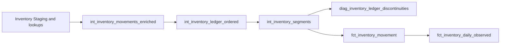

# Inventory Intermediate

The inventory chain reconstructs recorded observations within each dataset/product/warehouse ledger. Source `dataset_row_number` defines ledger order, including tied event timestamps. Opening and closing are recorded balances; received and issued are flows. Quantity signs, RETURN direction, UNKNOWN classifications and negative balances remain as recorded.



## int_inventory_movements_enriched

[SQL](int_inventory_movements_enriched.sql) retains one row per `inventory_movement_id`. It reads `stg_inventory_movements` and LEFT JOINs documents, products, warehouses and four roles of `stg_units`. Product code comes from the catalog; product descriptions remain those recorded on the movement.

Its 37 output fields include all 25 Staging fields, document/product/location/unit labels, `movement_date`, `recorded_delta_qty` and negative/UNKNOWN flags. The delta is received minus issued, independent of classification. No return is matched to sales, and flags do not remove or adjust records.

The direct consumer is `int_inventory_ledger_ordered`. [_movements.yml](_movements.yml) documents the full output. Balance, unit agreement, enrichment and source-preservation tests guard the line grain and arithmetic.

## int_inventory_ledger_ordered

[SQL](int_inventory_ledger_ordered.sql) is a full-rebuild table with one row per movement. `predecessors` partitions enriched records by dataset/product/warehouse and orders by source row. It retains the preceding movement, event time, closing quantity/unit and description. `continuity` compares current opening with that preceding closing.

The 48 fields consist of all enriched columns plus predecessor and continuity attributes. The first movement has no preceding balance and is marked `LEDGER_START`. Later rows are continuous when opening equals the preceding closing; otherwise the difference is a diagnostic gap. Generated movement IDs and event timestamps do not replace source order.

Its direct consumer is `int_inventory_segments`. The predecessor, unit and native ledger tests verify the selected prior row, ledger boundaries and quantity comparisons. [_inventory_history.yml](_inventory_history.yml) is the field reference.

## int_inventory_segments

[SQL](int_inventory_segments.sql) is a full-rebuild table that retains the movement grain. `assigned` starts a segment at ledger start or a continuity gap. `anchored` identifies that segment by dataset/product/warehouse/start sequence and collects its opening, extent and event-time metadata.

Segment metadata uses the entire segment; cumulative flow uses only rows through the current movement. Reconstruction is the segment opening plus cumulative received-minus-issued quantities using `Decimal(38,6)`. The 57 fields retain the ledger columns and add segment identity/bounds, opening/time/reason, cumulative delta and reconstructed closing.

Direct consumers are `fct_inventory_movement` and `diag_inventory_ledger_discontinuities`. An early row change can split or merge segments; even appending a row can update existing segment-end metadata. Rebuild the full affected chain after changes. Anchor/reconstruction and row-preservation tests, plus the segment unit fixture, protect these dependencies.

For example:

| Source row | Opening | Received | Issued | Closing | Meaning |
|---|---:|---:|---:|---:|---|
| 10 | 10 | 5 | 3 | 12 | First segment anchor |
| 20 | 12 | 0 | 2 | 10 | Same continuous segment |
| 30 | 20 | 0 | 1 | 19 | New anchor after an observed gap |

The second segment starts from recorded opening 20. The gap `20 - 10` remains diagnostic; adding it to receipts would invent a movement. Source row numbers need not be consecutive within a product ledger because they originate in the full dataset.

## diag_inventory_ledger_discontinuities

[SQL](diag_inventory_ledger_discontinuities.sql) is a view with one row per observed gap. It calculates the previous segment over the complete source-ordered ledger, then filters discontinuities. Filtering earlier would select the preceding gap rather than the preceding movement.

Its 24 fields expose adjacent IDs/sequences/times, the balance difference, unit, descriptions and segment context. `diagnostic_class` labels whether either adjacent description mentions `stokopname`; this keyword evidence does not establish a stocktake reset or cancellation. The view has no downstream dbt model and supports investigation. The discontinuity diagnostic test compares its entire expected gap set with the segment model.

## Run, check and modify

From the repository root:

```bash
uv run --locked inventory-dw-dss transform --select +fct_inventory_daily_observed diag_inventory_ledger_discontinuities dim_product dim_warehouse dim_unit dim_date
```

`transform --test --select MODEL_NAME` through the public CLI checks existing relations. See [inventory SQL tests](../../../tests/intermediate/README.md), [dbt execution](../../../README.md) and the two YAML contracts for complete checks. Source-row, window or arithmetic changes require predecessor, segment and daily reconciliation tests together. Staging inventory changes also affect sales stock-unit evidence, so run the complete build for acceptance.

[Source ordering](../../../../../docs/source-system.md) and [observed-stock semantics](../../../../../docs/data-semantics.md) define the interpretation boundary. These calculations retain gaps and observations; they do not establish physical or available inventory.
