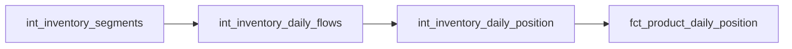

# Replenishment Intermediate

These models turn the source-ordered inventory ledger into a dense daily stock position, the input that forecasting, stockout-risk and order-quantity models need. They read `int_inventory_segments` and leave all existing inventory models unchanged.



## Operating assumptions

The observed marts deliberately avoid inventing balances. Replenishment needs a value for every day, so this layer applies standard perpetual-inventory rules, supported by the data:

| Rule | Evidence / consequence |
|---|---|
| A balance holds until the next movement | 99.98% of movements open at the previous closing; the remaining gaps occur mostly at stocktakes and are kept as `balance_gap_qty` |
| A day without movements has zero flows | The POS log and stock ledger are continuous exports; every sale is posted to the ledger |
| Ledger quantities are in the product's stock unit | Opening + received − issued = closing holds on every row, and each product has one stock unit across warehouses. Sales-line units can differ (196 products), so demand is taken from SALE issues, not `sold_quantity` |
| Stocktakes are flagged, not removed | `IMPORT_STOCKTAKE` rows and UNKNOWN rows described as `stokopname` set `has_stocktake` |
| Every ledger runs to the export end | The end date is the dataset's latest movement date, so quiet products still have positions |

## int_inventory_daily_flows

[SQL](int_inventory_daily_flows.sql) is a view at dataset × product × warehouse × movement date. It selects the day's first opening and last closing by source row, like `fct_inventory_daily_observed`, and splits flows into roles by `transaction_type`:

| Role | Source movements |
|---|---|
| `sold_qty` | SALE issues net of SALE receipts |
| `customer_return_qty` | RETURN |
| `purchase_received_qty` | PURCHASE, net of supplier returns |
| `transfer_in_qty`, `transfer_out_qty` | TRANSFER between warehouses |
| `adjustment_qty` | Everything else: stocktake, import/creation and UNKNOWN |

The roles sum to the recorded delta. Discontinuity gaps on the date are summed separately in `balance_gap_qty`.

## int_inventory_daily_position

[SQL](int_inventory_daily_position.sql) is a full-rebuild table. `calendar` expands each ledger from its first movement date to the export end. `joined` attaches the day's flows, using zero when no movement occurred. The final select carries the closing balance, stock unit and consignment status forward with `anyLast` over the ledger history. Each ledger rolls forward exactly: `on_hand(t) = on_hand(t−1) + net flows(t) + balance_gap(t)`.

Negative balances remain as recorded. Turning them into available stock is a consumer decision; see [replenishment marts](../../marts/replenishment/README.md).

## Run, check and modify

```bash
uv run --locked inventory-dw-dss transform --select int_inventory_daily_flows+
```

[replenishment_position_continuity](../../../tests/intermediate/replenishment_position_continuity.sql) proves contiguous dates, agreement with every observed closing and the roll-forward equation. A native fixture covers carry-forward and ledgers that start late. Changing a role mapping affects marts features but not balances; changing the calendar or carry-forward rule affects every downstream label.
