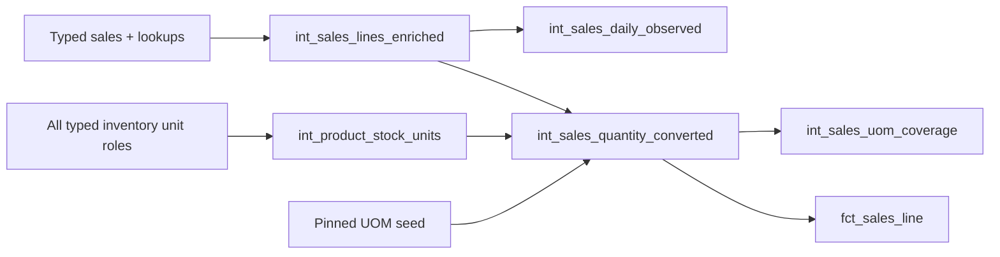

# Sales Intermediate

These five views preserve recorded sales and original units while adding reusable lookups, observed groupings and governed conversion. See [data semantics](../../../../../docs/data-semantics.md) before calling recorded sales demand or combining quantities.



All models below are views. Query cost includes their upstream SQL, not just view creation. Tests and typed contracts are in [_sales.yml](_sales.yml), [_uom.yml](_uom.yml), native unit fixtures and [SQL tests](../../../tests/README.md).

```bash
uv run --locked dbt build --select +fct_sales_line dim_product dim_unit dim_date --project-dir transform/dbt --profiles-dir transform/dbt --vars '{"uom_mapping_version":"uom_mapping_v2_2026-11-08"}'
uv run --locked dbt test --select int_sales_quantity_converted --project-dir transform/dbt --profiles-dir transform/dbt --vars '{"uom_mapping_version":"uom_mapping_v2_2026-11-08"}'
```

The first command includes sales ancestors and the three sales dimensions. Run a full build for handover acceptance or broad raw changes.

### Model: `int_sales_lines_enriched`

**Purpose:** Attach business codes, invoice/cashier labels and optional batch details to recorded sales.

**Grain:** One source sales line, sales_invoice_line_id. Materialization: **view**.

**Inputs:** [stg_sales_invoice_lines](../../staging/sales/stg_sales_invoice_lines.sql), [stg_sales_invoices](../../staging/sales/stg_sales_invoices.sql), [stg_products](../../staging/reference/stg_products.sql), [stg_units](../../staging/reference/stg_units.sql), [stg_cashiers](../../staging/reference/stg_cashiers.sql), [stg_product_batches](../../staging/inventory/stg_product_batches.sql).

**Main logic:**

1. Start from all typed sales lines.
2. LEFT JOIN invoice, product, unit and cashier; LEFT JOIN batch by batch ID and product.
3. Keep all 42 line/enrichment columns, derive sold_date from sold_at, preserve optional NULLs.

**Important columns:** `sales_invoice_line_id`, dataset/source row, `sales_invoice_number`, `product_code`, `unit_code`, `product_batch_number`, `expiration_date`, original quantities and financial fields.

**Output:** `int_sales_daily_observed`, `int_sales_quantity_converted`

**Business rules:** No sale eligibility filter, net-return calculation, warehouse inference or deduplication. Line-recorded labels stay line-recorded.

**How to modify it safely:** Check unique lookup keys and one output per line; do not replace original quantities or overwrite financials with inferred formulas.

**Tests:** `sales_enrichment_consistency`, unique grain, relationships, preserves_source_rows and native missing-batch/line-value fixture. Use the selected-model command in [dbt execution](../../../README.md) or the test instructions at the start of this README. Full column types and declared tests: [_sales.yml](_sales.yml).

### Model: `int_sales_daily_observed`

**Purpose:** Group recorded sales by product, observed date and original unit.

**Grain:** One (product_id,sold_date,unit_id) combination, across the current available export scope. Materialization: **view**.

**Inputs:** [int_sales_lines_enriched](int_sales_lines_enriched.sql).

**Main logic:**

1. Read product/date/unit/quantity/time from enriched lines.
2. GROUP BY product, date and original unit.
3. Sum original sold quantity, count lines and retain first/last sale time for observed groups.

**Important columns:** `recorded_sold_quantity`, `sales_line_count`, `first_sold_at`, `last_sold_at`.

**Output:** DSS queries and analytical joins; no downstream SQL model is configured.

**Business rules:** Grain has no dataset or warehouse. No absent dates, return-netting or cross-unit sum is introduced.

**How to modify it safely:** Preserve grouping and signed original values. A new grouping changes the contract and all reconciliation expectations.

**Tests:** `sales_daily_reconciliation`, unique grain, relationships and native daily grouping fixture. Use the selected-model command in [dbt execution](../../../README.md) or the test instructions at the start of this README. Full column types and declared tests: [_sales.yml](_sales.yml).

### Model: `int_product_stock_units`

**Purpose:** Establish whether a product has one supported recorded stock unit in an export.

**Grain:** One (dataset_name,product_id) with inventory observations. Materialization: **view**.

**Inputs:** [stg_inventory_movements](../../staging/inventory/stg_inventory_movements.sql), [stg_products](../../staging/reference/stg_products.sql), [stg_units](../../staging/reference/stg_units.sql).

**Main logic:**

1. GROUP BY dataset/product over movements from every warehouse.
2. Count distinct closing units and rows whose opening/received/issued units differ from closing.
3. Expose a stock_unit_id only for one closing unit with zero inconsistencies; attach exact product/unit labels.

**Important columns:** `recorded_stock_unit_count`, `inconsistent_unit_movement_count`, nullable `stock_unit_id`, `stock_unit_code`, `product_code`.

**Output:** `int_sales_quantity_converted`

**Business rules:** Unit equality is checked, not assumed. Evidence spans the export, not historical availability at each sale. Products with no inventory evidence are absent and become missing evidence in the sales LEFT JOIN.

**How to modify it safely:** Do not select an arbitrary unit or restrict evidence to one warehouse. Re-run stock compatibility and all historical sales conversion tests after evidence-rule changes.

**Tests:** `uom_stock_unit_evidence`, `uom_mapping_stock_compatibility`, unique grain and native cross-warehouse/four-role disagreement fixtures. Use the selected-model command in [dbt execution](../../../README.md) or the test instructions at the start of this README. Full column types and declared tests: [_uom.yml](_uom.yml).

### Model: `int_sales_quantity_converted`

**Purpose:** Add supported stock-unit quantities and mapping provenance without changing recorded sales.

**Grain:** One original sales line, sales_invoice_line_id; 57 output columns. Materialization: **view**.

**Inputs:** [uom_conversion_mapping](../../../seeds/uom_conversion_mapping.csv), [int_sales_lines_enriched](int_sales_lines_enriched.sql), [int_product_stock_units](int_product_stock_units.sql).

**Main logic:**

1. Select exactly the pinned mapping version and reject an unpublished version.
2. LEFT JOIN stock evidence by dataset/product/code and mapping by exact DrugCode/original unit; reject contradictory explicit identity factors.
3. Classify identity, approved, candidate, quarantined or unmapped. Apply factor 1 for verified identity; apply only positive Tier A approved factors with a compatible target.
4. Multiply using exact Decimal128 arithmetic; retain unresolved quantity/factor as NULL and stamp every line with the selected version.

**Important columns:** `sold_quantity`/`unit_id` remain original; `verified_stock_unit_id`, `conversion_status`, `applied_conversion_factor`, `stock_unit_qty`, `mapping_version` and evidence explain the result.

**Output:** `fct_sales_line`, `int_sales_uom_coverage`

**Business rules:** Candidate factors never enter arithmetic. Differently named units with factor 1 are approved conversion, not inferred identity. No cross-version fallback or warehouse FK.

**How to modify it safely:** Keep the full 42-column input and all 57 downstream fields. Re-run both supported mapping versions, source-preservation and UOM failure tests for changes; never edit published factors.

**Tests:** `uom_conversion_correctness`, selected version, mapping contract/compatibility, unique grain, preserves_source_rows, native statuses/Decimal/version fixtures and Python UOM integration. Use the selected-model command in [dbt execution](../../../README.md) or the test instructions at the start of this README. Full column types and declared tests: [_uom.yml](_uom.yml).

#### Conversion example

For an illustrative product with verified stock unit Tab, `2 Box` at an approved factor 10 gives `20 Tab`; `5 Tab` is identity with factor 1. If Box is candidate instead, its original 2 remains and `stock_unit_qty` is NULL. A product without stock evidence does not acquire a stock unit from the mapping alone. The actual approved factors remain in the governed seed.

### Model: `int_sales_uom_coverage`

**Purpose:** Expose conversion coverage within a product and its original sales unit.

**Grain:** One (dataset_name,product_id,unit_id,mapping_version); code labels accompany the group. Materialization: **view**.

**Inputs:** [int_sales_quantity_converted](int_sales_quantity_converted.sql).

**Main logic:**

1. Read classified original lines and their selected version.
2. Group by dataset/product/original unit/version and associated code labels.
3. Count each status and sum absolute original quantities into total, covered and unresolved amounts.

**Important columns:** `sales_line_count`, identity/approved/candidate/quarantined/unmapped counts, `absolute_sales_quantity`, `covered_absolute_sales_quantity`, `unresolved_absolute_sales_quantity`.

**Output:** DSS queries and analytical joins; no downstream SQL model is configured.

**Business rules:** Coverage is not a sales/stock total. Absolute values avoid sign cancellation. Never pool Box/Tab or different products into one quantity denominator; zero denominator yields missing percentage in the analysis.

**How to modify it safely:** Keep status partitions exhaustive and total = covered + unresolved. Document whether any new metric is row-, pair-, SKU- or quantity-weighted.

**Tests:** `uom_coverage_reconciliation`, unique grain, relationships and coverage analysis tests in the full build. Use the selected-model command in [dbt execution](../../../README.md) or the test instructions at the start of this README. Full column types and declared tests: [_uom.yml](_uom.yml).
