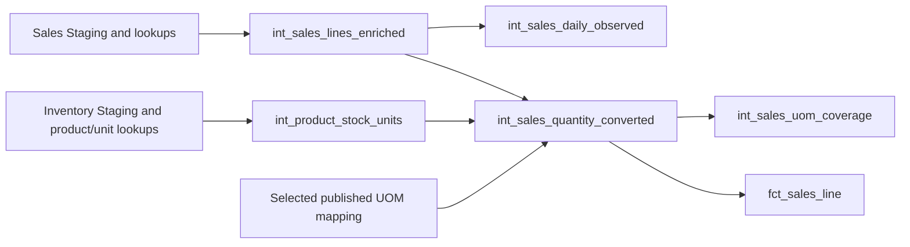

# Sales Intermediate

Five views turn typed sales into reusable recorded-sales and governed conversion outputs. The branch preserves original quantities, recorded amounts and source line identities. Field definitions are maintained in [_sales.yml](_sales.yml) and [_uom.yml](_uom.yml).



## int_sales_lines_enriched

[SQL](int_sales_lines_enriched.sql) provides one row per `sales_invoice_line_id`. It starts with `stg_sales_invoice_lines` and LEFT JOINs `stg_sales_invoices`, `stg_products`, `stg_units`, `stg_cashiers` and `stg_product_batches`. The batch join checks both batch and product identity.

The 42 output fields retain all 35 Staging values and add invoice/product/unit/cashier business codes, `sold_date` and batch number/expiry. Transaction-recorded product labels and monetary fields pass through; current catalog attributes do not replace them. Missing optional batch information retains the sales line.

Direct consumers are `int_sales_daily_observed` and `int_sales_quantity_converted`. Changes to lookups must preserve one parent per joined key and one output per source line. The enrichment/source-preservation tests and missing-batch unit fixture protect that contract.

## int_sales_daily_observed

[SQL](int_sales_daily_observed.sql) aggregates enriched sales into one row per `(product_id, sold_date, unit_id)`. This grain intentionally spans the currently loaded datasets: dataset and warehouse are not grouping keys.

Its seven fields are the three grouping keys, signed `recorded_sold_quantity`, `sales_line_count`, `first_sold_at` and `last_sold_at`. Quantity is the sum of original sales values in the given unit. Only observed combinations appear; there is no zero-filled calendar or stock-return adjustment.

There are no downstream dbt models. Consumers can use the view for observed original-unit sales, with its stated dataset scope. Grouping changes affect the daily reconciliation and unit-separation fixture.

## int_product_stock_units

[SQL](int_product_stock_units.sql) produces one row per `(dataset_name, product_id)` with inventory evidence. It reads `stg_inventory_movements` across all warehouses, then joins product and unit labels from `stg_products` and `stg_units`.

For each product/dataset, it counts distinct closing units and movements whose opening/received/issued units disagree with closing. A stock unit is exposed only when there is exactly one closing unit and no disagreement. Its seven output fields include the grouping identifiers, exact product/unit labels and both evidence counts. Products without inventory observations are absent from this view and have missing evidence in the sales LEFT JOIN.

The direct consumer is `int_sales_quantity_converted`. Evidence covers the loaded dataset rather than knowledge available at the sales event time. A new warehouse observation can therefore invalidate historical conversions for that product. Run the stock-unit evidence/compatibility tests and the full sales branch after a change.

## int_sales_quantity_converted

[SQL](int_sales_quantity_converted.sql) keeps one row per source sales line. It combines enriched sales, verified stock-unit evidence and one selected version of `uom_conversion_mapping`. Mapping `product_id` means DrugCode, so the exact match uses sales `product_code` and original `unit_code`.

The CTEs follow the decision sequence:

1. `selected_mapping` selects the pinned publication; `version_guard` rejects an unavailable version.
2. `matched` adds stock evidence and mapping provenance without dropping lines. An explicit factor that contradicts verified identity raises an error.
3. `classified` distinguishes identity, compatible Tier A approval, candidate, quarantined and unmapped outcomes.
4. The final projection applies factor one or the approved factor with exact decimal arithmetic. Other outcomes keep their original quantity and have no applied factor or converted quantity.

All 42 enriched input columns are retained among the 57 output columns. Added fields expose verified units, selected version, matched decision/evidence, status, applied factor and `stock_unit_qty`. Direct consumers are `fct_sales_line` and `int_sales_uom_coverage`.

Conversion depends on product codes, original units, all recorded inventory unit evidence and the selected mapping version. A change to any of those inputs requires rebuilding the conversion branch and sales fact. Published mapping updates follow the [seed guide](../../../seeds/README.md).

## int_sales_uom_coverage

[SQL](int_sales_uom_coverage.sql) reads converted lines at `(dataset_name, product_id, product_code, unit_id, unit_code, mapping_version)` grain. Its 16 fields include the grouping values, verified target label, total/status line counts and absolute original-unit quantity coverage.

The quantity denominator is `sum(abs(sold_quantity))` within one product and original unit. Covered quantity includes identity/approved lines; unresolved quantity includes the other statuses. These remain original-unit measures. The view feeds the [coverage analyses](../../../analyses/README.md) and DSS inspection; it has no downstream dbt model.

For example, `2 Box` and `5 Tab` remain separate original-unit observations. With a verified Tab stock unit and an approved factor of 10 Tab per Box, the first line also exposes 20 Tab. A candidate factor leaves its converted quantity missing. Coverage must show the unresolved line instead of replacing it with zero.

## Run, check and modify

Run from the repository root after extraction:

```bash
uv run --locked inventory-dw-dss transform --select +fct_sales_line dim_product dim_unit dim_date
```

For a specific model, use `transform --test --select MODEL_NAME` through the public CLI against current upstream relations. The [dbt guide](../../../README.md) explains ancestor/descendant selection; [tests](../../../tests/README.md) lists the source-preservation, conversion and coverage checks. Existing native fixtures cover missing batches, signed/precise values, cross-warehouse unit disagreement and conversion outcomes.

Edit reusable calculations in the owning model and update its field documentation beside the SQL. Validate all affected descendants, including sales when inventory evidence changes. The [business semantics](../../../../../docs/data-semantics.md) guide explains the limits on demand, warehouse assignment and monetary aggregation.
